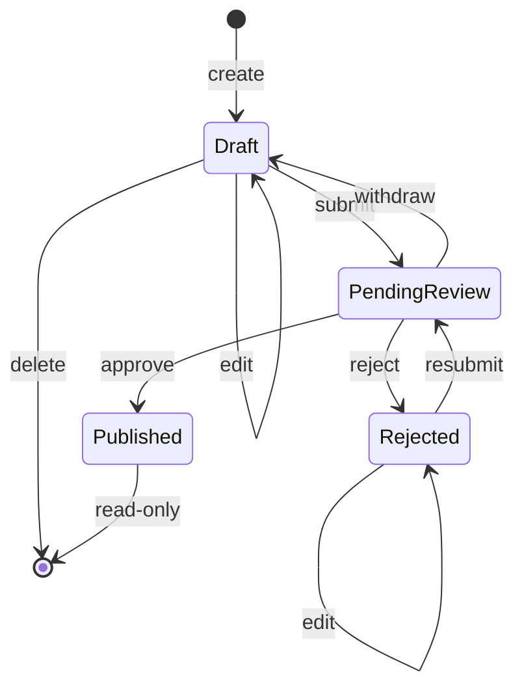

# Article lifecycle

An article moves through four statuses. The rules live in one place, `ArticleLifecycle` (`backend/src/ContentReview.Domain/Articles/ArticleLifecycle.cs`); the API, the portals and the tests all ask it what is allowed. This page is the reference; F16.2 finalizes it with the API and UI details.

## Transitions

These are the only valid ones. Anything else is refused.

| From | Action | To | Actor |
|---|---|---|---|
| Draft | Edit | Draft | Owner |
| Draft | Delete | (removed) | Owner |
| Draft | Submit | PendingReview | Owner |
| PendingReview | Withdraw | Draft | Owner |
| PendingReview | Approve | Published | Administrator |
| PendingReview | Reject | Rejected | Administrator |
| Rejected | Edit | Rejected | Owner |
| Rejected | Submit (resubmit) | PendingReview | Owner |

- **Published** allows no action to anyone: it is read-only.
- **PendingReview** cannot be edited or deleted; withdraw it first.
- A **Rejected** article can be edited and resubmitted but not deleted.
- Delete exists only for a Draft.

## What the domain offers

| Call | Answers |
|---|---|
| `CanPerform(status, action, actor)` | Whether this actor may do this action in this status. |
| `Next(status, action)` | The status afterwards (`null` for Delete, which removes the article). Throws `InvalidTransitionException` when no actor can do the action. |
| `AllowedActions(status, actor)` | The actions the actor may take, in the order Edit, Delete, Submit, Withdraw, Approve, Reject. The API sends them to the portals as `allowedActions` so the UI never has its own copy of the rules. |
| `EnsureCanPerform(status, action, actor)` | Throws `InvalidTransitionException` when not allowed. |

`Article` has the matching methods: `UpdateContent`, `EnsureCanDelete`, `Submit`, `Withdraw`, `Approve` and `Reject`. Each asks the state machine first, so no code path can bypass it. They change the article only; the submission snapshot (F09.2) and the review record (F10.2) are written by the services that call them.

What a transition changes on the article:

| Action | Changes |
|---|---|
| Submit | `status` PendingReview, `submissionVersion` + 1, `submittedAt` and `updatedAt` = now |
| Withdraw | `status` Draft (the submission count and `submittedAt` stay: they describe the last submission) |
| Approve | `status` Published, `publishedAt` = now |
| Reject | `status` Rejected (the reason belongs to the review record) |
| Edit | title, summary, body, category, `updatedAt` |

## Validation

### Drafts (saving)

A draft may be incomplete.

| Field | Rule |
|---|---|
| Title | required, 1-150 characters after trimming |
| Summary | optional, at most 500 |
| Body | optional, at most 20000 (plain text, never rendered as HTML) |
| Category | optional; must exist when given (checked by the service) |

NUL (`\0`) characters are removed from title, summary and body, because PostgreSQL text cannot store them.

### Submission

`ArticleSubmissionValidator` returns every broken rule at once, keyed by the API's field names.

| Field | Rule | Message |
|---|---|---|
| `title` | 5-150 characters after trimming | "Title is required." / "Title must be between 5 and 150 characters." |
| `summary` | 20-500 characters after trimming | "Summary is required." / "Summary must be between 20 and 500 characters." |
| `body` | at least 100 characters apart from surrounding spaces, at most 20000 in total | "Body is required." / "Body must be between 100 and 20000 characters." |
| `categoryId` | required | "Category is required." |

Padding with spaces never satisfies a minimum.

## Conflicts

- A refused action is a **409** with one sentence that names the status, for example "Article cannot be modified in status PendingReview." (Edit and Delete), "Article cannot be submitted in status Published." (Submit), and the same shape for withdrawn, approved and rejected.
- When an action is both not allowed and the article is incomplete, the **status conflict is reported**, not the field errors: Submit first asks the state machine, then the validator.
- A failed validation changes nothing on the article.

## Tests

`ArticleLifecycleTests` checks all 48 combinations (4 statuses x 6 actions x 2 actors) against the table above, written out again in the test, for `CanPerform`, `EnsureCanPerform` and `Next`, plus `AllowedActions` and the messages. `ArticleLifecycleEntityTests` covers the entity methods and `ArticleSubmissionValidatorTests` the limits.
