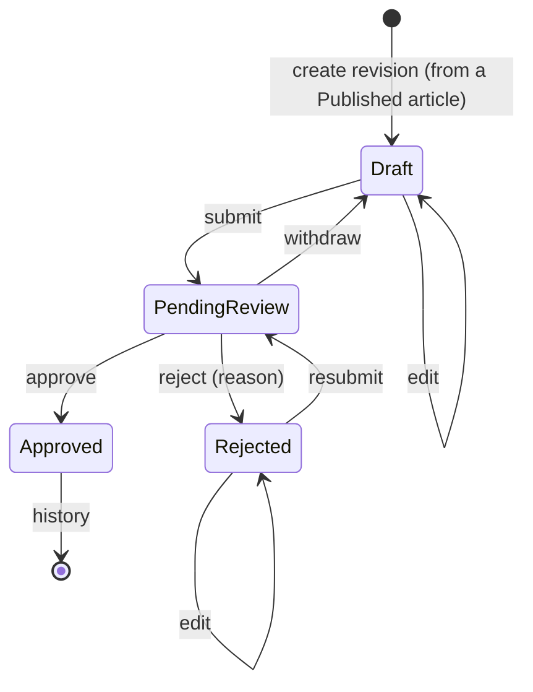

# Article revisions (edit a published article)

An author can edit a **published** article. The edit does not touch the published article: it becomes a *revision* that goes through its own review. Readers keep seeing the published version until an administrator approves the revision; a rejected revision never reaches them. Feature 17 (stories F17.1 and F17.2) supersedes the "Published is read-only" rule of [article-lifecycle.md](article-lifecycle.md).

## Revision lifecycle

`RevisionLifecycle` (`ContentReview.Domain/Articles/RevisionLifecycle.cs`) is the single table, next to `ArticleLifecycle`. The statuses are Draft, PendingReview, Rejected and Approved (`RevisionStatus`).

| From | Action | To | Actor |
|---|---|---|---|
| Draft | Edit | Draft | Owner |
| Draft | Submit | PendingReview | Owner |
| PendingReview | Withdraw | Draft | Owner |
| PendingReview | Approve | Approved | Administrator |
| PendingReview | Reject | Rejected | Administrator |
| Rejected | Edit | Rejected | Owner |
| Rejected | Submit (resubmit) | PendingReview | Owner |

- Starting a revision is only possible for a **Published** article without an open revision (`Article.EnsureCanRevise`, "Article cannot be revised in status X."). The article offers the action `revise` in `allowedActions` while that is true.
- An article has **at most one open revision** (any status except Approved). A partial unique index (`ux_article_revisions_open_per_article`) enforces it, so racing "create revision" requests start exactly one.
- The revision starts as a copy of the published content and uses the same draft limits when edited and the same submission rules when submitted (title 5-150, summary 20-500, body 100-20000, category).
- PendingReview is read-only; an Approved revision is history and allows nothing.

## What approval does

In **one transaction** (`RevisionDecisionService`):

1. the revision becomes `Approved` (`approved_at`);
2. the replaced published version is stored in `article_published_versions` (`Article.ApplyRevision` returns the snapshot);
3. the article's title, summary, body and category become the revision's, `published_at` = now and `published_version` + 1; the article stays `Published`;
4. a row in `revision_reviews` records reviewer, decision, time and submission version;
5. a `RevisionApproved` audit event is written.

**Reject** records the review (reason 10-1000 characters, shown to the author) and sets the revision to `Rejected`; the article is not touched. Earlier decisions stay in `revision_reviews` across edits, resubmissions and approval.

## Concurrency

Racing approve / reject / withdraw requests on a revision update the same row under the `xmin` check, and `revision_reviews` has a unique `(revision_id, submission_version)`: exactly one request wins, every other gets **409** with `currentStatus` and `currentVersion`. A decision is also refused (409) when the submission it was opened on is no longer the current one, when the version is stale, or when the author is suspended. Two revisions of one article can never exist at once, so they cannot be approved together. Revisions of different articles are independent.

## Which version readers see

`GET /api/feed` and `GET /api/feed/{id}` read the content of the **article** itself. The article only changes in step 3 above, so the feed always shows the latest approved version and never a revision that is being edited, pending or rejected.

## API

Author (`AuthorOnly`; another author's article is 404). The article id identifies the revision because there is at most one open:

| Endpoint | Purpose | Errors |
|---|---|---|
| `POST /api/articles/{id}/revision` | start a revision (201, `RevisionDto`) | 404, 409 not Published or one already open |
| `GET /api/articles/{id}/revision` | the open revision | 404 none |
| `PUT /api/articles/{id}/revision` | edit (`title`, `summary`, `body`, `categoryId`, `version`) | 400 draft limits, 404, 409 status / stale `version` |
| `POST /api/articles/{id}/revision/submit` | send for review (`version`) | 400 submission rules, 404, 409 |
| `POST /api/articles/{id}/revision/withdraw` | take it back (`version`) | 404, 409 |
| `GET /api/articles/{id}/revision/reviews` | decisions on all revisions, newest first, without the reviewer | 404 |

`ArticleDto` (and the items of `GET /api/me/articles`) also carry `publishedVersion` and `openRevision` (`id`, `number`, `status`, `updatedAt`).

Administrator (`AdminOnly`):

| Endpoint | Purpose |
|---|---|
| `GET /api/admin/reviews/queue` | pending articles **and** pending revisions; each item has `kind` (`Article` / `Revision`) and `revisionId` |
| `GET /api/admin/revisions/{id}` | the revision next to the published content (`published`), the author, the history with reviewers, `canReview` / `reviewBlockedReason`; 404 for a revision never submitted |
| `POST /api/admin/revisions/{id}/approve` | `{ version, submissionVersion }` |
| `POST /api/admin/revisions/{id}/reject` | `{ version, submissionVersion, reason }` |

Every endpoint is in Swagger (tags *Articles* and *Admin – Reviews*) with its status codes. See [api.md](api.md) for the shared conventions.

## Portals

- **Author Portal**: the article page offers "Edit published article" (action `revise`), shows the open revision's status and links to `/articles/:id/revision`. That page edits, saves, submits, resubmits and withdraws the revision, shows the rejection reason and the decisions, and handles a 409 with the unsaved text. "My articles" shows the revision status next to the published article.
- **Admin Portal**: the review queue has a *Type* column (Revision / New article). A revision opens at `/reviews/revisions/:id`: the published version and the revision side by side, approve / reject with the same conflict dialog as articles.

All user text is rendered as text, never as HTML.

## Audit (F17.2)

`RevisionCreated`, `RevisionSubmitted`, `RevisionWithdrawn`, `RevisionApproved` and `RevisionRejected` are written in the same transaction as the change, with the revision as entity and the details `{ articleId, revisionId, revisionNumber, submissionVersion }` (`reason` for a rejection). Refused or conflicting requests write nothing; content is never recorded. They appear in the admin audit history and its action filter. See [audit.md](audit.md).

## Tests

See [traceability.md](traceability.md).
