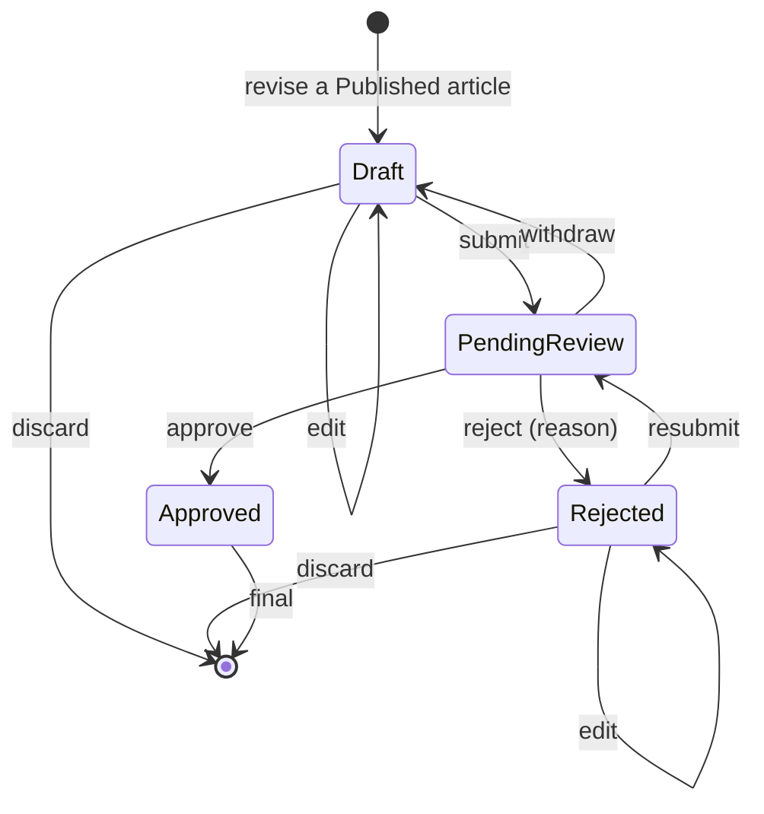

# Revisions of published articles

A published article is read-only, but its author can improve it. They do so through a **revision**: a separate version of the article with its own title, summary, body, category, status, submission time and submission count. Readers keep seeing the published version until an administrator approves the revision; then the revision's content replaces the published content in one step. Story F17.1.

## Lifecycle

The table lives in `RevisionLifecycle` (`backend/src/ContentReview.Domain/Articles/RevisionLifecycle.cs`), next to `ArticleLifecycle`, and the API sends it to the portals as `allowedActions`.

| From | Action | To | Actor |
|---|---|---|---|
| Draft | Edit | Draft | Owner |
| Draft | Delete (discard) | (removed) | Owner |
| Draft | Submit | PendingReview | Owner |
| PendingReview | Withdraw | Draft | Owner |
| PendingReview | Approve | Approved | Administrator |
| PendingReview | Reject (reason 10-1000 characters) | Rejected | Administrator |
| Rejected | Edit | Rejected | Owner |
| Rejected | Delete (discard) | (removed) | Owner |
| Rejected | Submit (resubmit) | PendingReview | Owner |

- **Starting** a revision is the article action `Revise` (Published, Owner). It is offered only while the article has no open revision.
- A **PendingReview** revision is read-only, so what the administrator reviews is what the author submitted. **Approved** is final.
- **Open** means Draft, PendingReview or Rejected. An article has **at most one open revision** (a partial unique index, not only a check in code), so two revisions can never be published at once. After an approval, or after discarding, a new revision can be started.
- Submit applies the same rules as an article (title 5-150, summary 20-500, body 100-20000, an existing category); saving applies the draft limits.
- A rejected revision keeps its reason; the author reads it, edits and resubmits. Earlier decisions on the same revision stay in its history (one row per submission in `revision_reviews`).
- Discarding a revision never touches the published article.
- Review actions are blocked while the author is suspended (409, as for articles). Somebody else's article or revision is a 404.

## What approval does

One transaction (`RevisionReviewService`):

1. the revision becomes `Approved`;
2. the article's title, summary, body and category become the revision's (`Article.ReplaceContentWith`), `publishedVersion` goes up by one and `currentVersionPublishedAt` is set (`publishedAt` keeps the date of the first publication);
3. the version that was replaced is written to `article_published_versions` (its text, the category, when it went live and when it was replaced, and the revision that replaced it);
4. the decision is stored in `revision_reviews`.

Readers therefore see either the old version or the new one, never a mix.

### The feed

A published article's own row always holds its **latest approved version**, because it only changes in step 2. `FeedService` reads that row and filters on `Published`, so a revision that is a draft, pending or rejected (a separate row in `article_revisions`) can never appear in the feed. Articles published before this story are version 1 of themselves (the migration sets `published_version = 1` and `current_version_published_at = published_at`).

## Concurrency

| Race | Outcome |
|---|---|
| Two requests start a revision of one article | The unique index lets exactly one in; the other gets 409 ("This article already has a revision in progress.") |
| Approve, reject and withdraw of one revision at the same moment | Every write is conditional on the revision's `xmin` (`version`) and each submission has one `revision_reviews` row; exactly one request succeeds, the others get 409 |
| Edit with a stale `version` | 409 with `currentVersion` |

## Data

See [database.md](database.md): `article_revisions`, `revision_reviews`, `article_published_versions` and the two new columns on `articles` (`published_version`, `current_version_published_at`). The migration is `AddArticleRevisions`.

## API

Routes, bodies and status codes: [api.md](api.md#revisions-of-published-articles-f171). The admin review queue lists new submissions and revisions together; each item has a `kind` (`Submission` or `Revision`).

## Author Portal

- `/articles/:id` (published article): the **Revise this article** button (`article-revise`) creates a revision and opens it; while a revision is open the page shows its status and a link instead (`article-revision`, `article-revision-status`, `article-revision-link`).
- `/revisions/:id` (`RevisionPage.tsx`): the editor for a Draft or Rejected revision (fields `revision-title`, `revision-summary`, `revision-body`, `revision-category`; **Save revision**, **Submit for review** / **Resubmit for review**, **Discard revision**), a read-only view with **Withdraw submission** while it is pending, and a read-only view once approved. It always says that readers keep the published version until the revision is approved, links to the published article, shows the rejection reason and the review history, and warns about unsaved changes. A 409 shows a banner with **Refresh**.
- `/articles` (My articles): a published article with an open revision shows its status next to the article status (`article-row-revision`, for example "Revision pending review") and an **Open revision** link.

## Admin Portal

- `/reviews` (queue): a **Type** column says "New submission" or "Revision" (`review-row-kind`); a revision links to `/reviews/revisions/:revisionId`.
- `/reviews/revisions/:revisionId` (`RevisionReviewPage.tsx`): the **published version** and the **revision** side by side (stacked on a narrow screen), with "(changed)" next to every field that differs, the author with account status, the review history of this revision, and **Approve revision** / **Reject revision**. Reject asks for the reason; a 409 opens a dialog with the current status and **Refresh**. Everything the author wrote is rendered as text.

## Not in this story

Audit events for revision actions are story F17.2.

## Tests

| What | Where |
|---|---|
| Lifecycle table, entity rules, history of replaced versions | `backend/tests/ContentReview.UnitTests/Domain/RevisionLifecycleTests.cs`, `ArticleRevisionTests.cs`, `ArticleLifecycleTests.cs` |
| API, queue, feed, suspended authors, ownership, races, database constraints | `backend/tests/ContentReview.IntegrationTests/Revisions/RevisionTests.cs` |
| Author Portal | `frontend/author-portal/src/pages/RevisionPage.test.tsx`, `ArticlePage.test.tsx`, `MyArticlesPage.test.tsx` |
| Admin Portal | `frontend/admin-portal/src/pages/RevisionReviewPage.test.tsx`, `ReviewQueuePage.test.tsx` |
| Whole flow in both portals | `e2e/tests/revisions.spec.ts` ([e2e/README.md](../e2e/README.md)) |
